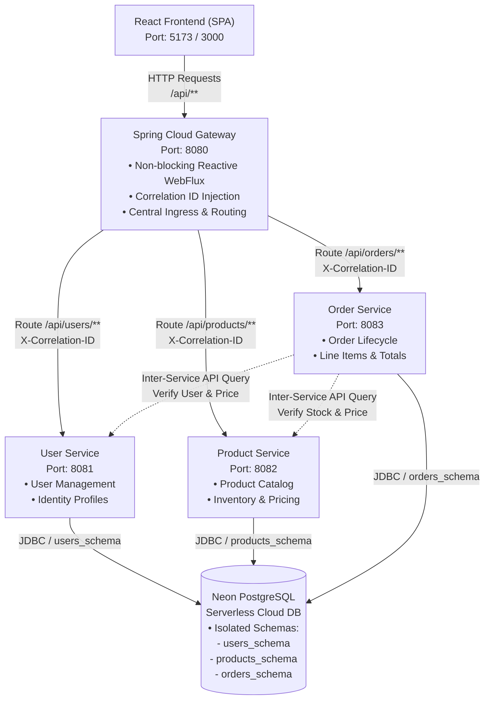

# System Architecture Specification

## Cloud-Based API Gateway and Microservices Management Platform
**Document Version:** 1.0.0  
**Target Milestone:** Day 1 Architecture & Skeleton  

---

## 1. High-Level Architecture Diagram

---

## 2. Component Responsibilities

### 2.1 React Frontend
- **Role:** Single-page user interface built with React and modern build tooling (Vite).
- **Ingress Strategy:** Strictly targets the Gateway at `http://localhost:8080` (configured via `VITE_API_GATEWAY_URL`). Does not directly couple to backend microservices.
- **Responsibilities:**
  - Visualize system topology and service operational health in real-time.
  - Interactive route tester to demonstrate end-to-end request/response flows.
  - User and product catalog browsing and checkout workflows.

### 2.2 Spring Cloud Gateway (`gateway`)
- **Role:** Centralized API management, reverse proxy, and edge routing layer built on **Spring Cloud Gateway (Reactive WebFlux)**.
- **Key Decision:** `spring-boot-starter-web` (servlet stack) is **strictly omitted** to prevent runtime class conflicts with Spring Cloud Gateway's Netty-based reactive engine.
- **Responsibilities:**
  - Route client requests matching `/api/users/**`, `/api/products/**`, and `/api/orders/**` to downstream services.
  - Inject or propagate `X-Correlation-ID` header across all downstream calls.
  - Expose fallback endpoints (`/fallback/service-unavailable`) when downstream services are unreachable.
  - Central entry point for CORS negotiation.

### 2.3 User Service (`user-service`)
- **Role:** Microservice managing customer and user identities.
- **Port:** `8081`.
- **Responsibilities:**
  - User registration, profile retrieval, and status tracking.
  - Input validation (valid email formats, non-blank names).
  - Persistence to `users_schema.users` in PostgreSQL.

### 2.4 Product Service (`product-service`)
- **Role:** Microservice managing the product catalog and inventory availability.
- **Port:** `8082`.
- **Responsibilities:**
  - Product creation, catalog search, price verification, and stock tracking.
  - Input validation (positive pricing, positive or zero stock).
  - Persistence to `products_schema.products` in PostgreSQL.

### 2.5 Order Service (`order-service`)
- **Role:** Microservice orchestrating order placement and lifecycle.
- **Port:** `8083`.
- **Responsibilities:**
  - Processing customer orders with multiple line items.
  - Calculating order subtotals and grand totals.
  - Validating user existence and product inventory via REST clients.
  - Persistence to `orders_schema.orders` and `orders_schema.order_items`.

---

## 3. Request and Response Flow

1. **Client Ingress:** External client (React SPA) issues an HTTP request to `http://localhost:8080/api/users` with optional header `X-Correlation-ID`.
2. **Gateway Filter Chain:**
   - **Pre-Filter:** `CorrelationIdGlobalFilter` inspects the request. If `X-Correlation-ID` is missing, generates a new UUID and mutates the request headers.
   - **Route Matching:** Gateway matches URI pattern `/api/users/**` against configured routes.
   - **Forwarding:** Request is proxied asynchronously via Netty HTTP client to `http://localhost:8081/api/users`.
3. **Microservice Processing:**
   - Downstream service (e.g. `user-service`) receives the request.
   - Controller extracts DTO, runs Spring Validation (`@Valid`).
   - Service layer executes domain logic and interacts with Spring Data JPA repository.
   - JPA executes queries within the service's isolated schema in Neon PostgreSQL.
4. **Response Egress:**
   - Downstream service returns HTTP response (e.g. 201 Created).
   - Gateway **Post-Filter** appends `X-Correlation-ID` to the HTTP response header and streams data back to client.

---

## 4. Service Boundaries and Data Ownership

| Principle | Architectural Rule |
| :--- | :--- |
| **Microservice Autonomy** | Each service runs in its own JVM process, has its own Maven build lifecycle, and maintains its own application configuration. |
| **Zero Direct DB Sharing** | The Order Service never joins or writes directly to `users` or `products` tables. If Order Service needs user data, it queries the User Service REST API. |
| **No Monolithic Aggregations** | Microservices do not import each other's entity classes or database models. DTOs and API clients represent the contracts. |

---

## 5. Gateway Route Mappings & Port Topology

| Service | Application Name | Local Port | Gateway Prefix | Downstream Target |
| :--- | :--- | :--- | :--- | :--- |
| **API Gateway** | `gateway` | `8080` | `/api/**` | Ingress Entry Point |
| **User Service** | `user-service` | `8081` | `/api/users/**` | `http://localhost:8081` |
| **Product Service** | `product-service` | `8082` | `/api/products/**` | `http://localhost:8082` |
| **Order Service** | `order-service` | `8083` | `/api/orders/**` | `http://localhost:8083` |
| **Frontend** | `frontend` | `5173` | N/A | React Vite Dev Server |

---

## 6. Planned Security and Traffic Management Roadmap (Day 4 Architecture)

The Day 1 skeleton establishes explicit extension points for Day 4 enhancements:

1. **JWT Authentication & Authorization Filter:**
   - Gateway will intercept requests to protected endpoints (`/api/orders/**`, admin routes).
   - Decodes and validates JWT signatures using public keys or shared HMAC secret from `JWT_SECRET`.
   - Injects user claims (`X-User-Id`, `X-User-Role`) downstream so backend services receive pre-authenticated context.
2. **Token-Bucket Rate Limiting:**
   - Gateway will implement rate limiting per API key or client IP using Redis or in-memory token buckets.
   - Protects downstream microservices from denial of service and noisy neighbors.
3. **Response Caching:**
   - Idempotent read endpoints (e.g., `GET /api/products`) will be cached at the Gateway edge with configurable TTL.
4. **Circuit Breaking & Resilience:**
   - Integration with Resilience4j for reactive circuit breakers on downstream routes.

---

## 7. Configuration and Secret Management Strategy

- **Environment-Variable Driven:** All sensitive configuration (passwords, URLs, tokens) is resolved via environment variables (`${DB_URL}`, `${DB_USER}`, `${DB_PASSWORD}`, `${JWT_SECRET}`).
- **Safe Local Defaults:** When environment variables are absent, Spring Boot falls back to embedded/in-memory test configurations so services boot without crashing during early development.
- **Zero Secrets in Code:** Passwords, API tokens, and production connection strings are never hardcoded in `application.yml` or checked into version control.

---

## 8. Health Check & Observability Approach

- Every Spring Boot microservice includes `spring-boot-starter-actuator`.
- Configured endpoints:
  - `GET /actuator/health` provides health readiness.
  - `GET /actuator/info` exposes application version and build metadata.
- Health endpoints avoid exposing sensitive environmental details or database credentials.

---

## 9. Error-Handling Conventions

- Global exception handlers (`@RestControllerAdvice`) intercept:
  - `MethodArgumentNotValidException` $\rightarrow$ Returns HTTP 400 with a map of field-level validation errors.
  - `ResourceNotFoundException` $\rightarrow$ Returns HTTP 404 with resource identification.
  - `Exception` (catch-all) $\rightarrow$ Returns HTTP 500 without leaking stack traces or internal query structures.
- All errors are formatted into the canonical `ErrorResponse` schema with correlation `requestId`.

---

## 10. Baseline vs. Optimized Gateway Comparison Plan

To quantify the architectural advantages of the Gateway in future milestones (Day 5/6 benchmarking), we define a comparative evaluation strategy:

1. **Metrics Measured:**
   - **Throughput:** Requests per second (RPS).
   - **Latency Percentiles:** p50, p95, p99 response times.
   - **Cache Hit Ratio:** Percentage of read requests served directly by Gateway edge cache.
   - **Rejection Accuracy:** Percentage of abusive requests correctly throttled with HTTP 429 under load.
2. **Scenarios Compared:**
   - **Baseline:** Uncached direct requests with default routing.
   - **Optimized:** Gateway routing with edge caching, connection pooling, and proactive rate limiting.
